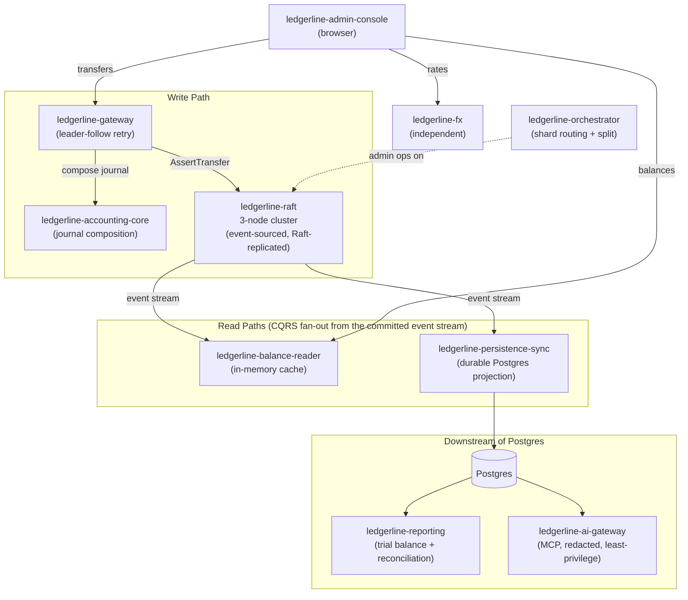

# Ledgerline

**Ledgerline** is an original, open-source distributed ledger platform —
a Raft-replicated, event-sourced core engine plus the gateway, read-path,
accounting, FX, reporting, sharding, and AI-access layers built around it.

It's inspired by the well-known, publicly documented architectural patterns
behind production ledger systems (Raft consensus, event sourcing, CQRS,
double-entry bookkeeping) — **it is not derived from, and contains no code
from, any proprietary system.** Every repo here was built from scratch for
this project, verified against a real, running stack at each step (not just
unit-tested in isolation), and several real bugs found during that
verification are documented below rather than swept under the rug.

## Layout

This is a monorepo: each service below is a subdirectory with its own
`go.mod` (or, for the admin console, its own `package.json`) and its own
README — independently buildable on its own, but versioned together here
with its full original commit history preserved (each service started life
as its own repo; see `git log -- <dir>` to see that history).

| Directory | Role |
|---|---|
| [`ledgerline-raft`](./ledgerline-raft) | The core: a Raft-replicated, event-sourced ledger engine. Idempotent `AssertTransfer`, double-entry by construction, a committed-event stream for CQRS fan-out. |
| [`ledgerline-accounting-core`](./ledgerline-accounting-core) | Double-entry journal composer + GL-dimension rule engine. Classifies a transfer's business context into GL account/cost center before it's submitted to the ledger. |
| [`ledgerline-gateway`](./ledgerline-gateway) | Client-facing REST API. Leader discovery/retry into the raft cluster, composes journals via accounting-core first. |
| [`ledgerline-balance-reader`](./ledgerline-balance-reader) | Fast CQRS read-path: tails the engine's event stream into an in-memory cache instead of querying the engine on every read. |
| [`ledgerline-persistence-sync`](./ledgerline-persistence-sync) | Projects committed events into durable Postgres tables — the queryable system of record for reporting/reconciliation. |
| [`ledgerline-fx`](./ledgerline-fx) | Independent FX rate service: static seed rates + optional live refresh, cross-rate derivation, conversion. |
| [`ledgerline-orchestrator`](./ledgerline-orchestrator) | Demo shard-split controller: routing table + a (simplified) split operation that stands up a new cluster, replays history into it, and atomically swaps routing. |
| [`ledgerline-reporting`](./ledgerline-reporting) | Trial Balance / reconciliation batch CLI reading the Postgres projection. Exits non-zero if debits ≠ credits. |
| [`ledgerline-ai-gateway`](./ledgerline-ai-gateway) | An MCP server exposing read-only ledger-query tools to AI agents, with field-level redaction, a least-privilege DB role, and audit logging. |
| [`ledgerline-admin-console`](./ledgerline-admin-console) | A small local demo web UI: balances, a transfer form, FX rates. |
| *(repo root)* | This README, `docker-compose.yml`, and the demo scripts tying everything together. |

## Architecture



**Data flow for a transfer**: a client calls `ledgerline-gateway`, which asks
`ledgerline-accounting-core` to classify the transfer into a balanced,
GL-tagged journal, then submits it to `ledgerline-raft` as one or two
idempotent `AssertTransfer` calls (two, if there's a fee split — see
"Known simplifications" below). The raft leader commits it to its replicated
log, applies it to the state machine, and emits it on the committed-event
stream. `ledgerline-balance-reader` and `ledgerline-persistence-sync` both
tail that same stream independently — one for fast in-memory reads, one for
a durable, queryable Postgres projection. `ledgerline-reporting` and
`ledgerline-ai-gateway` both read from that Postgres projection, never from
the engine directly, so analytics and AI-agent access are strictly read-path
concerns that can never compete with or block the operational write path.

## Running it

**Docker:**
```sh
./scripts/demo.sh
```
Brings up the whole stack, runs an end-to-end demo (accounts, a fee-split
transfer, idempotency check, fast-path vs. engine-path reads, trial balance,
an MCP tool call), then tells you what to try next (the admin console is at
http://localhost:5180). Fully verified live, including every container
reporting `healthy`, a real transfer applying through gateway → raft →
balance-reader/persistence-sync, the reporting CLI's reconciliation passing
inside its own container, and a genuine MCP protocol round-trip against the
dockerized `ai-gateway` showing `cost_center` correctly redacted.

**Without Docker:**
```sh
./scripts/local-demo.sh
```
Builds and runs every service as a plain OS process against a local
Postgres (`createdb ledgerline` first). Same end-to-end flow, also fully
verified live — this is the path used throughout most of this project's
development, before Docker Desktop finished its (surprisingly slow,
interactive-feeling) first-run initialization.

## Cross-cutting observations (and real bugs found along the way)

Mirroring the style of the architecture research this project was inspired
by: here's what actually went wrong while building it, not just what works.

- **A JSON-tag bug silently zeroed every field.** `accounting.TransferContext`
  (the accounting-core REST wrapper's request type) had no `json:"..."`
  struct tags, so `encoding/json` fell back to matching the Go field names
  verbatim — meaning every snake_case wire field (`amount_minor`,
  `from_account`, ...) silently decoded to its zero value. Every request
  failed with a confusing "amount must be positive" error. This slipped
  through the repo's own unit tests (which call `ComposeJournal` directly as
  a Go function, never through JSON) and was only caught when
  `ledgerline-gateway`'s live integration test actually exercised the real
  HTTP endpoint. **Lesson**: unit-testing business logic in isolation doesn't
  catch wire-format bugs at the boundary — you have to actually call the API.
- **No CORS headers, anywhere.** All the Go HTTP services were built and
  verified via `curl`, which doesn't enforce CORS. The first time the
  browser-based `ledgerline-admin-console` tried to call them, every request
  failed with a CORS preflight error. Fixed with a small permissive
  (wildcard) CORS middleware in `gateway`, `balance-reader`, and `fx` —
  documented in each as a local-demo-only simplification, not something
  you'd want on a public deployment.
- **A single, per-transfer GL code, not per-leg.** `ledgerline-raft`'s
  `AssertTransfer` takes one `gl_account`/`cost_center` pair for the whole
  transfer (it's a simple two-party primitive), while
  `ledgerline-accounting-core` can assign *different* GL codes to the debit
  and credit legs. The gateway currently tags a raft-level transfer with the
  **credit leg's** GL code, which means `ledgerline-persistence-sync`'s
  journal rows end up with the same GL code on both sides of a given
  raft-level transfer — e.g. a fee-split payout's debit leg shows up under
  the credit leg's revenue GL code (`4000`), not its own payout code
  (`2100`). The books still balance (debits = credits, globally and per
  transfer), it's just coarser GL attribution than the full accounting-core
  model supports. A real fix would extend `AssertTransfer`'s wire shape to
  carry a GL code per leg.
- **`sync_state` is a single global counter with no notion of "which
  cluster."** `ledgerline-persistence-sync` resumes from
  `sync_state.last_raft_index` on restart — which is exactly right for
  resuming against the *same* cluster, but means pointing it at a **fresh**
  raft cluster while reusing an **old** Postgres database makes it resume
  from the old cluster's index and silently skip every event from the new
  one. Found while writing `scripts/local-demo.sh`, which re-ran against the
  same long-lived local Postgres database used throughout this project's
  development. Both demo scripts now reset state first (`docker compose down
  -v` / dropping the projection tables) specifically to avoid this.
- **A bash subshell gotcha leaked two zombie processes.** An early version of
  `scripts/local-demo.sh` started a couple of services as `(cd dir && binary
  args) &`, then tried to kill them via the subshell's PID on exit. Bash
  doesn't forward signals from a backgrounded subshell to its foreground
  child automatically, so `kill` hit the subshell (which was likely already
  done) while the actual binary kept running and held its port open,
  breaking the *next* run. Fixed with `(cd dir && exec binary args) &`,
  which replaces the subshell's process image with the binary instead of
  forking a child — so the tracked PID *is* the binary's PID. Confirmed fixed
  by checking `lsof` for leaked listeners after a run.

- **A `localhost` healthcheck against a hostname-bound listener.** The raft
  nodes bind their HTTP API to their own compose hostname (`raft-n1:8080`,
  not `0.0.0.0:8080`) on purpose — that exact string is what gets embedded in
  `-peers` and echoed back to callers as `leader_hint`, so it has to be
  something other containers can actually dial. The first version of
  `docker-compose.yml`'s healthcheck probed `http://localhost:8080/healthz`
  from *inside* that same container — which doesn't work, because binding to
  a specific hostname/interface in Go's `net.Listen` does not also bind the
  loopback interface. All three raft containers came up `unhealthy` (even
  though the application itself was working perfectly — raft leader election
  and replication succeeded in the logs the whole time), which cascaded into
  every dependent service refusing to start. Fixed by pointing each node's
  healthcheck at its own hostname instead of `localhost`. Found by actually
  running `docker compose up` and reading the failure, not by inspection.

## License

MIT — see each repo's own `LICENSE` file.
